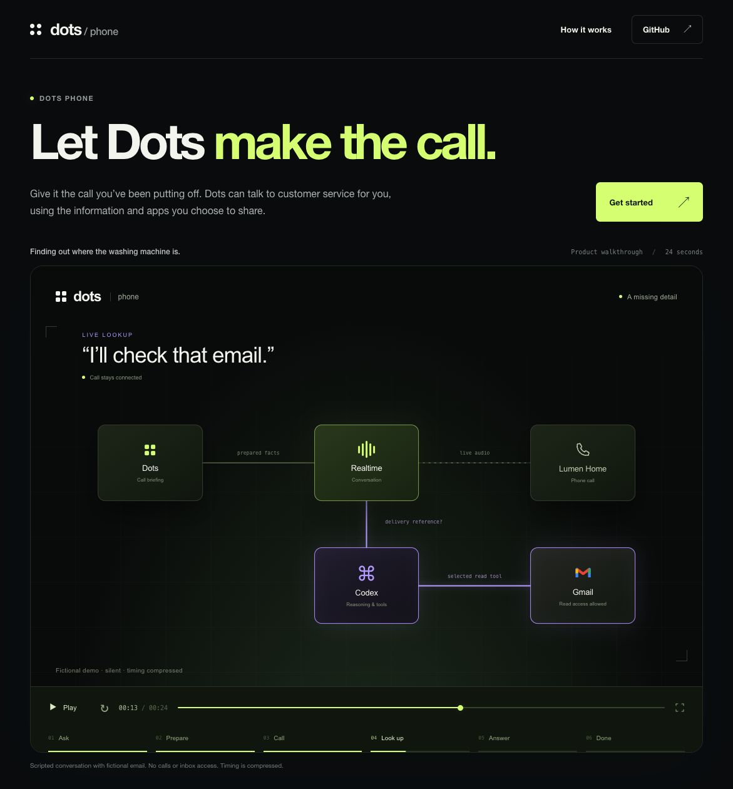
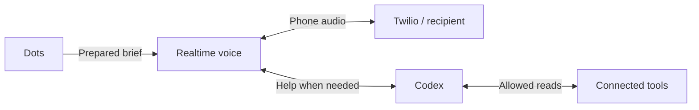

# Dots Phone

### Let Dots make the call.

A phone assistant for the errands that still require a conversation.

[](https://dots-phone.gabeaa.chatgpt.site)

**[Set up with Codex](#set-up-with-codex)** · [Watch the example](https://dots-phone.gabeaa.chatgpt.site) · [Test results](docs/VALIDATION.md)

> “Find out when my replacement washing machine will arrive.”

Dots gathers the order details and writes a brief before dialing. If the retailer
asks for a delivery reference that wasn’t included, Codex can find it in a connected
Gmail account during the call. Dots then reports what the retailer confirmed.

The demo uses fictional details. This is an **experimental preview** you run on your
own computer, with your own accounts and credentials.

## Set up with Codex

The repository includes a [setup skill](.agents/skills/dots-phone-setup/SKILL.md)
for installation, separate from the phone skill used to make calls. Paste this
prompt into Codex; it loads the setup guidance even before the plugin is installed.
You will still complete account sign-ins and hidden local credential entry.
[The quickstart](docs/QUICKSTART.md) explains what to get and where.

```text
Set up https://github.com/gabeosx/dot-phone-plugin on this computer.

Inspect existing tools, checkouts and services. Clone into a new folder or
reuse a suitable checkout without overwriting its files. Read and follow
.agents/skills/dots-phone-setup/SKILL.md, docs/QUICKSTART.md and docs/LOCAL-SETUP.md.
Load the setup skill directly from that file if it is not in your skill list.

Complete the routine setup you can. Guide me through local sign-ins and the
hidden terminal prompts for credentials; never ask for secrets in chat or put
them in command arguments or tracked files. Preserve existing keys, budgets,
source permissions and explicit choices. Use the same private config.env for
all Compose commands.

For a new install, enable the recommended DeepFilterNet3 filtering unless I
opt out: install verified weights outside the repo, build its native image,
and run its isolated local streaming checks before activating the overlay.
Keep recordings, models and private test results outside the repo. Report any
failed prerequisite instead of claiming filtering is active from its flag alone.

Keep dry-run enabled. Do not place calls, query email, purchase anything or run
paid model tests. Verify service/gateway health, the reasoner heartbeat, filter
configuration and the linked phone tools and packaged workflow where available.
Finish with what is ready, any remaining sign-in/configuration steps, and the
restart/rollback instructions.
```

You’ll need:

| Requirement | What it’s for |
| --- | --- |
| Docker Compose, uv, Node and Codex CLI | Run the local service and reasoning worker. uv installs Python 3.13 and the locked dependencies. |
| OpenAI API project | Realtime voice. API usage is billed separately from ChatGPT. |
| Twilio account and voice-capable number | Connect the call to the telephone network. Carrier charges apply. |
| ChatGPT access to Codex and custom MCP/plugin registration | Connect Dots and run the signed-in reasoning worker. |
| HTTPS/WSS tunnels | Let ChatGPT and Twilio reach the service on your computer. |

Gmail, Yahoo Mail and other connected sources are **optional**. You can start with
facts you provide. Installing Dots Phone does not grant access to your inbox.

**[Dependencies, credentials and setup steps →](docs/QUICKSTART.md)**

[DeepFilterNet3 noise reduction](docs/DEEPFILTER.md) is recommended enabled for
normal setup. It runs locally, needs no recipient voice sample, keeps weights in
an external cache and has an explicit off switch. The setup skill installs and
checks its prerequisites before enabling it. [Release notes](docs/RELEASE-NOTES.md) describe the current preview.

## What happens during a call



The voice model answers ordinary questions from the brief. Codex handles missing
information, harder decisions and final result review. The local service enforces
the call’s scope and limits and stores encrypted call records. Model requests go
to OpenAI; phone audio travels through Twilio.

Results can be incomplete when a source is unavailable or the conversation is
unclear. See the [validation record](docs/VALIDATION.md) for measured response times
and what has—and hasn’t—been tested.

## Working on the project

```sh
uv sync --frozen --extra pipecat --python 3.13
uv run python -m dots_phone.checks offline
```

These checks use fixtures and mocks; they do not call anyone.

[Local setup](docs/LOCAL-SETUP.md) · [Operations](docs/RUNBOOK.md) · [Privacy](docs/PRIVACY.md)

[MIT licensed](LICENSE). [Third-party licenses and notices](docs/DEPENDENCY-LICENSES.md) are retained.
